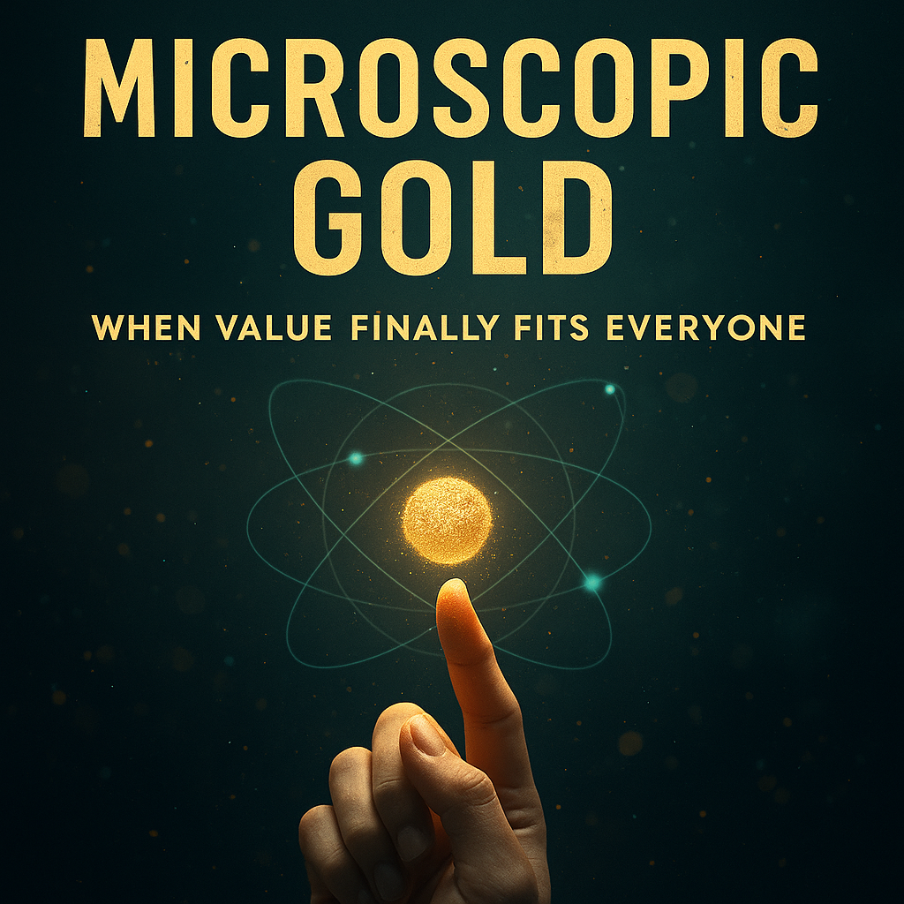
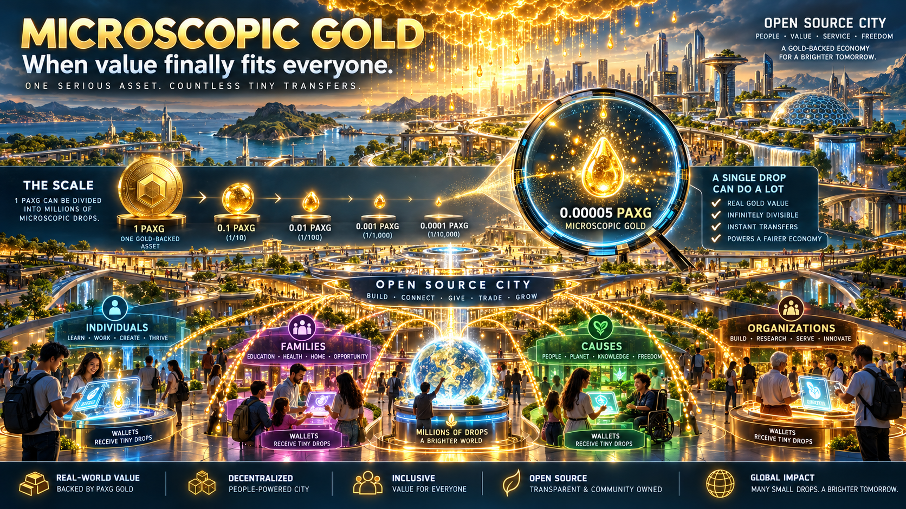

  

<em>Gold reduced to its smallest usable form.</em>

---

# Microscopic Gold — Public Anchor Repo

> **Microscopic Gold — When value finally fits everyone.**

---

## 🌟 Short Brand Story

Microscopic Gold turns the ancient power of gold into something anyone can own, one tiny piece at a time. By using PAXG to convert even a few dollars into real, asset-backed gold, it transforms loose change into lasting value—just as old jars of copper pennies once quietly grew beyond their face value. From pennygold to digitalpaydirt, golddustcoins, modernminers, and paxgdrops, the ecosystem celebrates the idea that wealth no longer requires size: meaningful value can now flow in microscopic form, accessible to everyone, instantly, and without barriers.

---

## 💡 What Is Microscopic Gold?

Microscopic Gold is a family of ideas, domains, and flows built around one core belief:

> **Even the smallest amount of value deserves a serious home.**

Instead of waiting to “one day” afford a full bar, gram, or coin, Microscopic Gold uses **PAXG** (asset-backed digital gold) to let people:

- convert **small amounts** of money into fractional gold exposure  
- treat **loose change** like **digital paydirt**  
- experience **ownership**, not just speculation  

No minimums, no fancy setups, just tiny pieces of a serious asset.

## Microscopic Gold in Open Source City

Microscopic Gold is not limited to saving. Tiny amounts of PAXG can also be earned, gifted, distributed, or exchanged.

Within Open Source City, the concept expands from individual ownership into a broader system of voluntary participation — one serious asset divided into many small, meaningful transfers.

 

## 🧬 Ecosystem Brands

Microscopic Gold is expressed through several related names and concepts:

- **pennygold**  
  Tiny savings become tiny pieces of gold — the modern version of the old jar of copper coins, but earning real gold value instantly.

- **digitalpaydirt**  
  A cleaner, transparent form of “paydirt” where the thrill of discovery meets clearly stated, measurable gold value.

- **golddustcoins**  
  Micro-ownership with emotional weight — holding gold “dust” in digital form, backed by real metal.

- **modernminers**  
  A community of people who “dig” with knowledge instead of tools, extracting value one small PAXG purchase at a time.

- **paxgdrops**  
  Branded drops of microscopic gold value — educational drops, gratitude drops, reward drops, savings drops. A cousin of Random Rain / StimulusDrops.

- **weacceptpaxg.crypto / weacceptpaxg.learn**  
  Early signals that real-world participants (shops, creators, communities) can choose to **accept PAXG** as part of everyday exchange.

---

## 🧱 Why PAXG?

Microscopic Gold builds on **PAX Gold (PAXG)** because it:

- is **backed 1:1 by physical gold**  
- is **divisible**, making micro-ownership possible  
- is **transparent** and **trackable** on-chain  
- allows for flows, drops, and micro-savings without shipping metal

Microscopic Gold is not a custodian, exchange, or financial advisor.  
It is a **conceptual and educational framework** for understanding how even tiny amounts can matter.

---

## 🔄 Flows & Use Cases (Conceptual Only)

Examples of how Microscopic Gold might be used:

- **Micro-savings jars**  
  Converting small regular amounts (e.g., $3–$10) into fractional gold-based positions.

- **paxgdrops for learning**  
  Rewarding students, creators, or early adopters with microscopic PAXG to spark curiosity and long-term thinking.

- **Merchant experiments**  
  Small shops or online sellers test “We Accept PAXG” banners to see who is ready to use tokenized gold.

- **Digital paydirt packs**  
  Themed or educational bundles where the joy of discovery meets transparent value.

All of the above are **concept sketches**, not products or offers.

---

## 📂 Repo Structure (Planned)

This repo is a **public-facing anchor**, not a finished app.

Planned folders may include:

- `Docs/`  
  - `BrandStory_Long.md` – the full narrative origin story  
  - `Ecosystem_Map.md` – diagram of all related names and flows  
  - `PAXG_Notes.md` – general educational notes about how PAXG works

- `Concepts/`  
  - `Microscopic_Value_Principles.md`  
  - `paxgdrops_Concepts.md`

These can be added gradually as the idea evolves.

---

## 📜 License

Text and concept content in this repo is intended to be shared under a Creative Commons license (recommended: **CC BY-NC-SA 4.0**), preserving:

- attribution to the originator  
- non-commercial use by others  
- share-alike when remixed

> This can be updated once a final decision is made.

---

